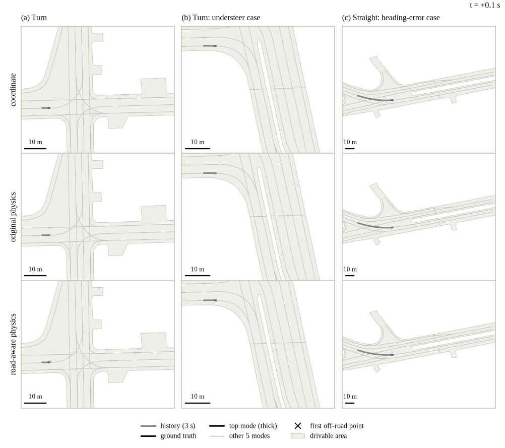

# Physics-Constrained Transformer for Motion Forecasting

A compact Transformer for vehicle trajectory forecasting on [Argoverse 2](https://www.argoverse.org/av2.html),
with two interchangeable decoders. The **coordinate head** regresses future positions. The **physics
head** predicts acceleration and steering and integrates them through a differentiable kinematic
bicycle model, so every trajectory is drivable by construction.

The goal is not the most accurate forecaster. It is to build a physically accurate model and measure
how it performs against an otherwise identical unconstrained one. Bounded controls also matter for
ride comfort: a smooth ride avoids heavy steering and harsh acceleration, so it is useful to see how a
model limited to such controls performs. The bounds used here rule out extreme manoeuvres; a
comfort-tuned model would set them tighter.

[Technical report (PDF)](report/report.pdf) ·
[Pretrained weights](https://github.com/tali7965/Physics-Constrained-Transformer-for-Motion-Forecasting/releases/tag/v1.0) ·
[Development log](docs/development-log.md)



*Top: coordinate head. Middle: original physics head. Bottom: road-aware physics head (seed 0,
lane re-ranking enabled). Thick paths are the most probable modes; thin paths show the other five.
All rows use the same scenes and plot bounds. These scenes were selected for the original-head
diagnostics, including understeering and initial-heading errors, not as a representative sample.
Across the full validation set and three seeds, top-mode off-road falls from 5.25% to 1.50%; the
animation shows individual predictions, not aggregate rates. In (a), the road-aware top mode
stays on-road but takes the wrong branch (36.3 m final error): road adherence is not intent accuracy.*

## Results

Argoverse 2 validation split (24,988 scenarios), K = 6 unless noted. Feasibility and off-road are
measured on the most probable trajectory of vehicle-like agents.

| Decoder | brier-minFDE | minFDE | MR | minFDE (K=1) | Infeasible (10 Hz / 2 Hz) | Off-road |
| --- | --- | --- | --- | --- | --- | --- |
| Coordinate head | **2.57** | **1.94** | **0.303** | **6.09** | 57.8% / 0.0% | **1.5%** |
| Coordinate head + 0.9 s filter | **2.57** | **1.94** | 0.304 | 6.10 | 0.9% / 0.0% | **1.5%** |
| Physics head | 3.16 | 2.55 | 0.431 | 6.95 | **0.0% / 0.0%** | 5.2% |
| Road-aware physics head (Phase 8) | 3.10 | 2.50 | 0.402 | 6.79 | **0.0% / 0.0%** | **1.5%** |
| Road-aware physics head, no re-ranking | 3.10 | 2.50 | 0.402 | 6.86 | **0.0% / 0.0%** | 3.5% |

The road-aware rows are means over training seeds 0, 1 and 2 (see Phase 8 in the development log).

The gap holds across ablations (brier-minFDE at each model's own K; minFDE for K = 1):

| Setting | Full data | Seed 1 | 25% data | 10% data | No map | K = 3 | K = 1 |
| --- | --- | --- | --- | --- | --- | --- | --- |
| Coordinate head | **2.57** | **2.56** | **2.88** | **3.33** | **3.18** | **3.17** | **5.19** |
| Physics head | 3.16 | 3.18 | 3.61 | 3.98 | 3.58 | 3.72 | 5.81 |

### Findings

- The physics head eliminates infeasible trajectories but trails by 0.4–0.7 m in every setting, and
  less training data does not narrow the gap.
- The coordinate head's infeasibility is step-to-step jitter: at 2 Hz its trajectories are as
  feasible as the ground truth.
- Drivable is not road-aware. The bicycle model limits how the vehicle moves, not where it goes.
  Because position is the running sum of the controls, small heading or steering errors compound
  into drifts across the lane: an uncorrected initial heading, or an incomplete turn. That is why the
  physics head leaves the road more often.
- Integration also gives early controls about 60× the gradient of late ones, so late steering
  learns slowly.
- Both are fixable without giving up the constraint (Phase 8): a learned initial-state correction, a
  heading loss and a lane loss bring the physics head's off-road share down to the coordinate head's.
- A light filter makes the coordinate head smooth for free. A 0.9 s Savitzky–Golay filter on its
  output cuts 10 Hz infeasibility from 58% to 0.9% with no change in accuracy. Fitting the bicycle
  model to its output instead costs accuracy, because the fit must start from the noisy current
  heading.

### Road-aware physics head (Phase 8)

The physics head's off-road excess had three diagnosed causes (see Findings). Phase 8 addresses each
one and keeps every trajectory drivable:

| Cause | Change | Where |
| --- | --- | --- |
| The noisy initial heading is never corrected | The head predicts a bounded correction of the initial heading (±11.5°) and speed (±1.5 m/s) per mode | `physics.correct_state`, `model.init_correction` |
| Late steering learns slowly, so turns stay incomplete | Heading loss on the winning mode: heading depends on steering through one sum, not two | `train.yaw_weight` |
| Drivable is not road-aware | Hinge loss on every mode beyond 2.5 m from the nearest lane centerline | `src/lanes.py`, `train.map_weight` |
| The most probable mode may be the one that leaves the road | At run time, lower a mode's score per metre it strays beyond 1.5 m from every lane | `eval.lane_rerank` in the config, on by default; `--no-rerank` turns it off |

The lane distance uses only the lane centerlines the model already receives, so it needs no raw map
and no new preprocessing, and the re-ranking is a legitimate run-time step. Over three training seeds
each (val, mean ± std):

| | brier-minFDE | minFDE, K=6 | Off-road, most probable mode | Off-road, all 6 modes | Infeasible |
| --- | --- | --- | --- | --- | --- |
| Physics head | 3.149 ± 0.013 | 2.540 ± 0.010 | 5.25% ± 0.07 | 5.74% ± 0.12 | 0.0% |
| Road-aware physics head | **3.101 ± 0.053** | **2.504 ± 0.051** | **1.50% ± 0.17** | **2.48% ± 0.14** | 0.0% |

Off-road falls by about 70% for the most probable mode (to the coordinate head's 1.5%) and by 57% over
all modes, every road-aware seed beats every baseline seed on both, and accuracy improves rather than
degrades. Details and ablations are in the
[development log](docs/development-log.md#phase-8-a-road-aware-physics-head).

```bash
python src/train.py --config configs/physics-roadaware.yaml
python src/evaluate.py --checkpoint outputs/runs/physics-roadaware/best.pt   # re-ranking is on by default (eval.lane_rerank)
```

## Installation

Requires Python 3.12 (`av2` ships macOS arm64 wheels for Python 3.9–3.12 only).

```bash
python3.12 -m venv .venv
source .venv/bin/activate
pip install -r requirements.txt
```

## Data

Scenarios are fetched from the public Argoverse S3 bucket with [s5cmd](https://github.com/peak/s5cmd)
and preprocessed into fixed-shape, agent-centric arrays. Set `AV2_DATA_ROOT`, or `data_root` in
`configs/preprocess.yaml`, to the storage location.

```bash
export AV2_DATA_ROOT=/path/to/av2
python src/download.py --split train      # 47 GB; also --split val (5.9 GB) and --split test (4.1 GB)
python src/preprocess.py --split train    # also --split val and --split test
```

The training subset is sampled from the full train split, so the whole split is required.

## Usage

### Pretrained weights

```bash
curl -L --create-dirs -o weights/physics.pt \
  https://github.com/tali7965/Physics-Constrained-Transformer-for-Motion-Forecasting/releases/download/v1.0/physics.pt
python src/evaluate.py --checkpoint weights/physics.pt
```

`transformer.pt` (the coordinate head) is in the same release. The road-aware physics head (Phase 8,
seed 0) is `physics-roadaware.pt` in the v1.1 release:

```bash
curl -L --create-dirs -o weights/physics-roadaware.pt \
  https://github.com/tali7965/Physics-Constrained-Transformer-for-Motion-Forecasting/releases/download/v1.1/physics-roadaware.pt
python src/evaluate.py --checkpoint weights/physics-roadaware.pt
```

### Training

```bash
python src/train.py --config configs/transformer.yaml   # coordinate head
python src/train.py --config configs/physics.yaml       # physics head
python src/train.py --config configs/physics-roadaware.yaml   # road-aware physics head
```

A full run takes about 3 h on an Apple M4. Ablation configs are in `configs/phase5/`.

### Evaluation and analysis

```bash
python src/evaluate.py --checkpoint outputs/runs/physics/best.pt        # validation metrics
python src/visualize.py --split val --random 6 --checkpoint outputs/runs/physics/best.pt
python src/diagnose.py --physics outputs/runs/physics/best.pt --coordinate outputs/runs/transformer/best.pt
python src/smooth.py --checkpoint outputs/runs/transformer/best.pt --split val   # smoothing comparison
python src/submit.py --checkpoint outputs/runs/physics/best.pt --split test   # submission file
```

## Repository structure

```text
configs/            experiment configs (YAML); phase5/ and roadaware/ hold the ablations and seeds
src/
  download.py       dataset download from S3
  preprocess.py     raw scenarios -> agent-centric arrays
  models.py         LSTM and Transformer forecasters, coordinate and physics heads
  physics.py        differentiable kinematic bicycle model, initial-state correction
  lanes.py          distance to the nearest lane centerline: lane loss and lane re-ranking
  train.py          winner-takes-all training with dev-set model selection
  evaluate.py       Argoverse 2 metrics, feasibility and off-road rates
  diagnose.py       physics-head diagnostics
  smooth.py         post-hoc smoothing of the coordinate head
  figures.py        report figures
report/             technical report (LaTeX source and PDF)
docs/               development log
```

## Future work

Smoothness alone no longer needs the physics head: the filtered coordinate head is already smooth and
accurate. A physics-based decoder still matters where every trajectory must be guaranteed to stay within
limits.

The physics head's failures concentrate in sharp turns. On the dev set it leaves the road in 2.4% of
straight-road scenes (coordinate head 0.5%) but in 18.2% of turns of 30° or more (6.8%). A **hybrid
decoder** could keep drivable output where it is cheap and avoid the worst failures: physics-constrained
on straight roads and gentle curves, coordinate-based in sharp turns. Two things would decide whether it
pays off:

- The switch has to be predicted at run time, for example from the lane geometry ahead, since the
  true turn is unknown.
- The physics head's 0.68 m gap on straight roads, mostly its uncorrected initial heading, has to
  close too.

This is open for anyone to pick up.

## Citation

```bibtex
@misc{taheri2026physics,
  author       = {Ali Taheri},
  title        = {Drivable by Construction, Behind on Accuracy: A Kinematic Decoder for
                  Transformer Motion Forecasting on Argoverse 2},
  year         = {2026},
  howpublished = {\url{https://github.com/tali7965/Physics-Constrained-Transformer-for-Motion-Forecasting}}
}
```

## License

The code is released under the [MIT License](LICENSE). Argoverse 2 data is © 2021 Argo AI, LLC,
licensed under [CC BY-NC-SA 4.0](https://creativecommons.org/licenses/by-nc-sa/4.0/). The pretrained
weights and figures are derived from it and are for non-commercial use only.
